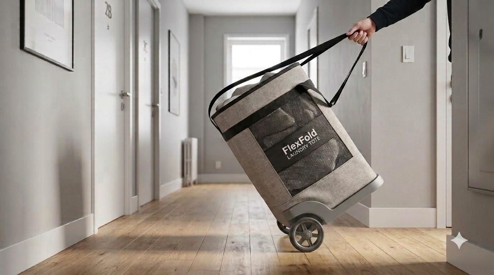
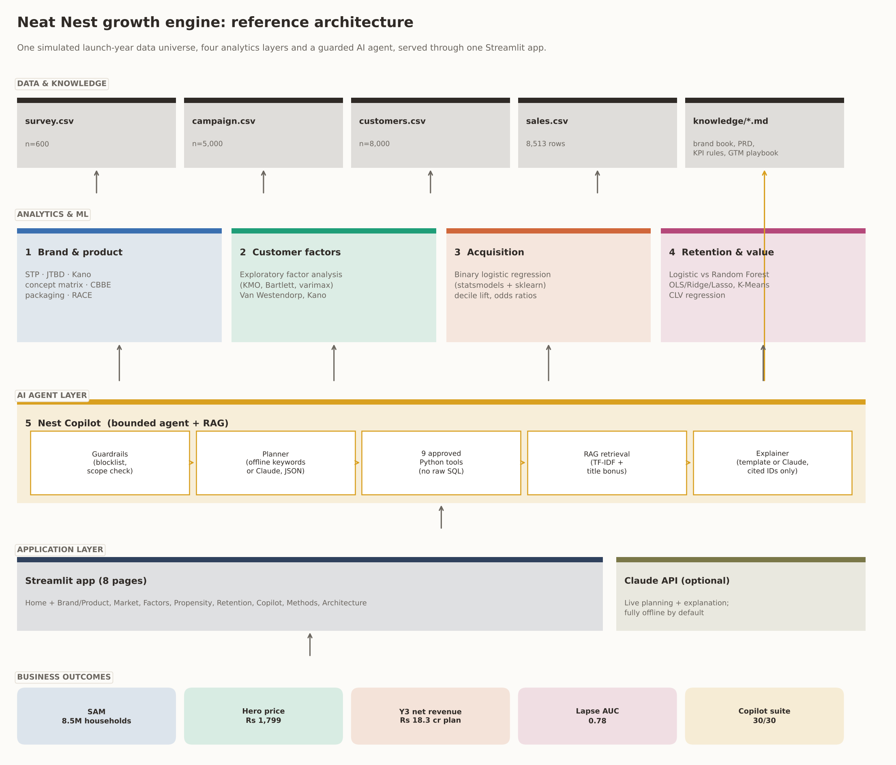
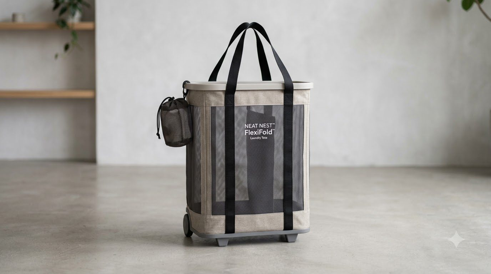
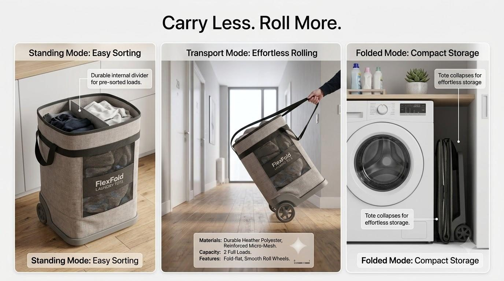
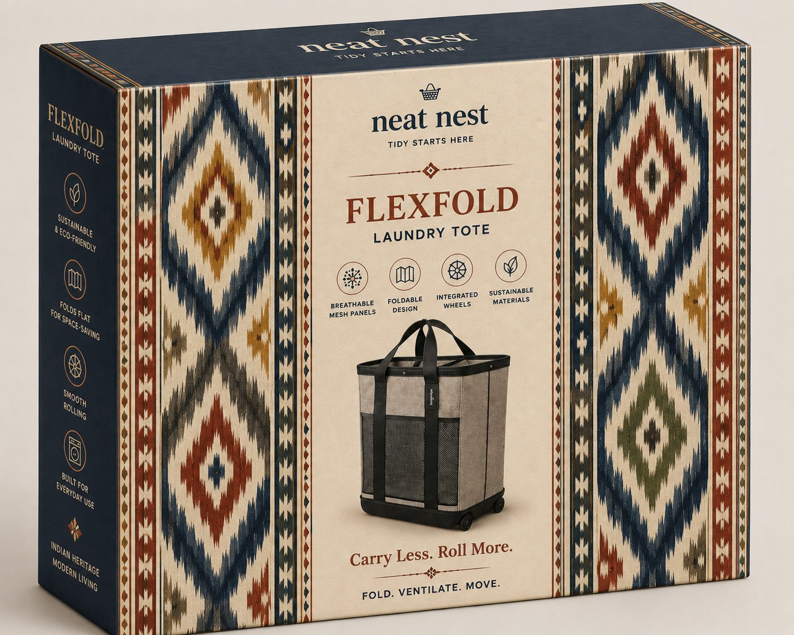
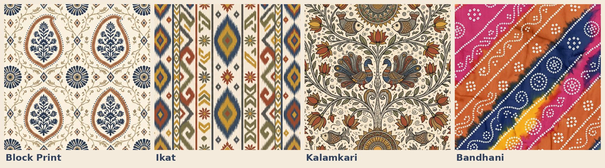

<div align="center">

# 🧺 Neat Nest Growth Engine

**One brand, five connected layers: brand strategy → customer research → acquisition → retention → a guarded AI copilot.**

[](https://neat-nest-growth-engine-lbrpssupgyjbzmptdb8gbk.streamlit.app/)
[](https://www.python.org/)
[](https://streamlit.io/)
[](https://scikit-learn.org/)
[-D97757?style=flat-square&logo=anthropic&logoColor=white)](https://www.anthropic.com/)
[](#quick-start)
[](LICENSE)

*Tidy Starts Here.*



</div>

Neat Nest is a D2C home-organisation brand launching **FlexFold**, a fold-flat, wheeled, three-compartment
laundry system for India's space-constrained apartments. This repository connects brand strategy, customer
research, acquisition modelling, retention analytics and a guarded LLM copilot, all running on **one simulated
launch-year data universe** — so the numbers on one page explain the numbers on the next. It began as five
separate pieces of MBA coursework (Product & Brand Management, Factor Analysis, Binary Logistic Regression,
an Advanced Analytics retention project, and a Generative/Agentic AI & RAG project) and is rebuilt here as one
integrated system, end to end.

**▶ [Try the live app](https://neat-nest-growth-engine-lbrpssupgyjbzmptdb8gbk.streamlit.app/)** — no install needed.

| Layer | Question | Method | Headline (simulated launch year) |
|---|---|---|---|
| 1 · Brand & market | Is there a real, reachable market, and at what price? | Washing-machine-anchored TAM/SAM/SOM, unit economics, Van Westendorp | SAM **8.5 M households**; hero at **Rs 1,799** sits inside the acceptable range (Rs 1,210-1,850); Y3 plan **Rs 18.3 cr** |
| 2 · Customer factors | What separates the personas? | Exploratory factor analysis (numpy: KMO, Bartlett, varimax), Kano | 3 factors, **69.5%** variance, KMO **0.73** |
| 3 · Acquisition | Who buys after the launch campaign? | Binary logistic regression (statsmodels + sklearn pipeline) | Holdout AUC **0.75**; top 3 deciles hold **66%** of buyers; *Will it fit?* quiz OR **2.45** |
| 4 · Retention & value | Which owners will lapse, and what are they worth? | Logistic vs Random Forest, OLS/Ridge/Lasso, K-Means | Lapse AUC **0.78** (logistic = forest); 4 owner segments |
| 5 · Nest Copilot | Can a manager ask all of this in plain English, safely? | Bounded agent, JSON-schema plans, TF-IDF RAG, optional Claude | Offline suite **30/30** |

---

## Reference architecture

Data & knowledge → analytics & ML → AI agent layer → application layer → business outcomes. The full,
annotated version of this diagram — plus a per-layer "you are here" strip — is generated by
[`scripts/make_diagrams.py`](scripts/make_diagrams.py) and lives on the app's **🧭 Architecture** page.



---

## The brand

<p align="center">
  
  
  
</p>
<p align="center">
  
</p>

Tilt-and-roll wheels, three removable compartments, antimicrobial liners and a fold to 8 cm — wrapped in an
**India Craft Heritage** sleeve system: one structure, five regional craft stories (Block Print · Ikat ·
Kalamkari · Bandhani · Madhubani), so each launch city leads with its own.

---

## Quick start

```bash
git clone https://github.com/anvesha2402/neat-nest-growth-engine.git
cd neat-nest-growth-engine
python -m venv .venv && source .venv/bin/activate      # Windows: .venv\Scripts\activate
pip install -r requirements.txt
streamlit run Home.py
```

On first run the app builds the data, models and reports (about 20 seconds). To rebuild everything,
including the static figures in `reports/figures/` and the diagrams in `assets/diagrams/`, run:

```bash
PYTHONPATH=src python -m neatnest.pipeline
PYTHONPATH=src python scripts/make_diagrams.py
```

Run the tests (39: market maths, factor analysis, models, copilot guardrails, mocked Claude client, every app page):

```bash
python -m pytest -q
```

### Live AI mode (optional)

The copilot works fully offline. To let Claude plan and explain:

```bash
export ANTHROPIC_API_KEY=your-key            # never commit this
export NEST_COPILOT_MODEL=claude-haiku-4-5-20251001   # optional; this is the default
streamlit run Home.py
```

Then choose **Live AI (Claude)** in the copilot sidebar and tick the consent box. On Streamlit Community Cloud,
put the key in *Settings → Secrets* as `ANTHROPIC_API_KEY = "..."`.

---

## Frameworks, methods & tech stack

A reference index of every named framework, model and library used somewhere in this project — the same
index is browsable by layer on the app's **🧭 Architecture** page.

**1 · Brand, product & market**
STP (Segmentation-Targeting-Positioning) · Jobs To Be Done with Forces of Progress (push / pull / anxiety / habit) ·
Kano model · Van Westendorp Price Sensitivity Meter · TAM-SAM-SOM market sizing · weighted concept-selection
matrix · Keller's CBBE pyramid (salience, performance, judgements, resonance) · brand architecture (master
brand + product family) · RACE digital marketing framework · SMART objectives · GST-aware pricing ladder
(HSN 6307) · contribution-margin waterfall (CM1/CM2/CM3) · channel economics · unit economics.

**2 · Customer factors**
Exploratory Factor Analysis built from scratch in numpy — KMO sampling adequacy, Bartlett's test of sphericity,
principal-axis extraction, Varimax rotation, eigenvalues & scree criterion, communalities, factor scores —
cross-validated against Kano classification and Van Westendorp price bands.

**3 · Acquisition**
Binary logistic regression (statsmodels `Logit` for odds ratios + scikit-learn `Pipeline` for leakage-free
cross-validation) · ROC-AUC holdout evaluation · McFadden pseudo-R² · decile lift / gains charts · VIF
multicollinearity diagnostics.

**4 · Retention & value**
Logistic regression vs. Random Forest (lapse risk) · permutation feature importance · OLS, Ridge & Lasso
regression (12-month customer value) · K-Means clustering with silhouette scoring · Customer Lifetime Value
modelling · a "lapse" redefinition of churn for durable goods.

**5 · Nest Copilot (agentic AI / RAG)**
Bounded / guarded LLM agent pattern (Python computes, the LLM only plans and explains) · Retrieval-Augmented
Generation via TF-IDF + cosine similarity with a title-term bonus · forced JSON-schema tool calls (Anthropic
Messages API) · prompt-injection & scope-blocklisting guardrails · hallucination checks (no-digits-in-prose
rule, citation-ID verification) · model cards · offline-first design with an optional live-LLM mode · fixed
regression test suite.

**Engineering**
Python `src/` package layout · scikit-learn Pipelines · joblib model persistence · pytest + Streamlit
`AppTest` · Streamlit multi-page apps · matplotlib & Plotly on a validated, colour-vision-deficient-safe brand
palette · reproducible, seeded data simulation.

---

## How the layers connect

```
Brand & product ──► Customer factors ──► Acquisition ──► Retention & value
(STP personas,       (do personas         (Digital Engagement   (lapse = no accessory,
 RACE quiz, CBBE)     really differ?)      + prior spend + quiz  referral or care-hub use
                                           predict purchase)     in months 7-12)
        │                    │                    │                     │
        └────────────────────┴──── Nest Copilot ──┴─────────────────────┘
             brand book · PRD · KPI rules · GTM playbook = retrieval corpus
             propensity · lapse risk · segments           = callable tools
```

* **Brand → factors.** The STP personas (Anjali, hostel students, young couples, seniors) are tested against
  latent survey dimensions instead of being assumed.
* **Factors → acquisition.** *Digital Engagement* and prior home-organisation spend become propensity features.
  The RACE *Act*-stage "Will it fit?" quiz, designed to answer the fit anxiety found in the JTBD interviews, is the
  strongest single signal.
* **Acquisition → retention.** FlexFold is a durable good, so monthly churn is the wrong lens. *Lapse* (no accessory,
  referral or care-hub activity in months 7-12) makes the CBBE *Resonance* layer measurable.
* **Everything → copilot.** The knowledge base the copilot retrieves from **is** the brand book, PRD and playbook.

## Nest Copilot design

```
question → blocklist → plan (offline keywords | Claude, forced JSON-schema tool) → validate_plan()
        → approved Python tool → TF-IDF retrieval (+ title-term bonus) → explanation
        (template | Claude: no digits, cited IDs only, ≤3 actions) → evidence + downloadable audit record
```

* **Python computes every number.** The model never sees the full dataset and cannot run code or SQL.
* **9 approved operations:** total, breakdown, trend, compare, explain (decline diagnosis), knowledge,
  targeting, customer_risk, segment_profile. **5 metrics:** net sales, gross profit, gross margin, units, discount.
* **Fails safely:** ambiguous questions get a clarifying question, forecasts are declined, a missing month raises an
  error instead of being counted as zero, and any live prose containing digits or unknown sources falls back to the template.
* **Planted test case:** in March 2028 a Kalamkari sleeve stock-out hits Hyderabad. Asking *"Why did sales decline in
  Hyderabad?"* returns a −34% fall, with Heritage Edition accounting for 63% of it and units down 83%, and points to the
  stock-out policy.

## Repository map

```
Home.py                     Streamlit entry (Home)
pages/                      0 Architecture · 1 Brand & Product · 2 Market & Pricing · 3 Customer Factors
                            4 Campaign Propensity · 5 Retention & CLV · 6 Nest Copilot · 7 Methods & Limits
src/neatnest/
  config.py                 every business assumption, with source / estimate tags
  market.py                 TAM/SAM/SOM, unit economics, 3-year plan
  generate_data.py          seeded simulation of survey, campaign, customers, sales
  research.py               KMO, Bartlett, principal extraction + varimax, Van Westendorp, Kano
  propensity.py             statsmodels logit + sklearn pipeline, CV, decile lift
  retention.py              lapse models, value regression, K-Means, retention scenario
  copilot/                  planner, tools, knowledge (RAG), llm (Claude), engine, evaluate
  pipeline.py · figures.py  end-to-end build, static analysis charts (reports/figures/)
scripts/make_diagrams.py    reference-architecture diagram + per-layer strips (assets/diagrams/)
knowledge/                  brand_book.md · prd.md · kpi_rules.md · gtm_playbook.md  (RAG corpus)
data/                       survey.csv · campaign.csv · customers.csv · sales.csv  (simulated)
assets/                     product & brand photography, assets/diagrams/ (architecture images)
models/ · reports/          trained pipelines, results.json, figures, copilot evaluation
notebooks/                  01-05 executed walkthroughs
tests/                      pytest suite incl. Streamlit AppTest
```

## Data dictionary (short)

| File | Rows | Key fields |
|---|---|---|
| `survey.csv` | 600 | 9 factor items + age, persona, laundry context, 4 Van Westendorp prices, 7 Kano pairs |
| `campaign.csv` | 5,000 | age, income, digital engagement, prior home-org purchases, site visits, quiz completed, source, **purchased** |
| `customers.csv` | 8,000 | first SKU/channel, care-hub logins, WhatsApp opens, accessory orders/spend, tickets, NPS, referrals (months 1-6), **lapsed_m7_12**, value_12m |
| `sales.csv` | 8,513 | date, city, SKU/product, family, channel, sleeve, units, MRP, discount, net_sales (ex-GST), cost |

## Honest limits

* **The business data is simulated** (seed 2027). Effect directions are designed to match the primary interviews
  and published benchmarks. The models show the *decision system*; their coefficients are not market evidence.
* Market inputs marked `EST` in `config.py` (household size, basket ownership and life, reachable share, unit cost,
  CAC) need validating with Phase-0 research and vendor quotes.
* Propensity scores rank prospects but are not calibrated probabilities. The quiz effect is associational.
* Owner segments overlap (silhouette 0.16). The 12-month value regression is partly mechanical.
* The copilot's offline parser is keyword-based. Live Claude mode is covered by mocked unit tests, not a live evaluation.

## Sources for market inputs

GST on textile made-ups (5% up to Rs 2,500, 18% above): Tally Solutions · Amazon India Home Storage fees: Shiprocket ·
households and washing-machine ownership: Data for India · urbanisation: SBI Research · Time Use Survey 2024: MoSPI via
Business Today · competitor prices: IKEA India, Pepperfry, Flipkart, Joseph Joseph · home-storage market: IMARC.
Full strings live in `SOURCES` in `src/neatnest/config.py`.

## Author

**Anvesha Singh**, PGDM E-Business (2025-27), WeSchool Mumbai.
Marketing · brand & product management · research · analytics · applied AI.

Licensed under MIT. Brand imagery in `assets/` © Anvesha Singh, not covered by the code licence.
